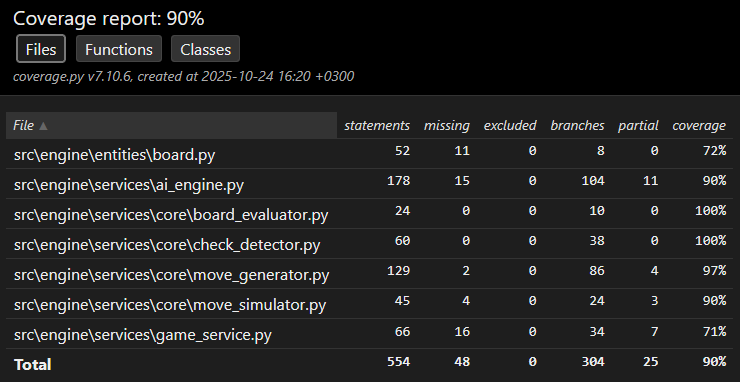

# Testing
The application has automated testing and has been manually verified to work on both Windows 10 and Ubuntu operating systems.

## Automated testing
### Application logic
The chess engine logic is mainly tested by a single TestPawn class, which attempts various different pawn-related moves and ensures illegal moves are not allowed. Each piece type does not need to be tested separately, as these tests focus on verifying the application logic chain is intact. The higher-level logic flow does not change significantly regardless of which piece has been moved. 

In addition to general game logic testing, there are separate tests for verifying that only legal moves can be made during check, as well as testing some of the game's end states. The AI engine is tested with tactical puzzles that verify correct decision-making under pressure. Tests include forcing a mate-in-two through discovered check and pawn promotion, avoiding trap captures where taking material would lead to greater losses (validating quiescence search), and finding defensive castling as the only move to prevent immediate checkmate.

### Test coverage
The test coverage for the application logic currently stands at 90%.

## System testing
The application has been manually tested to work on both Windows 10 and Ubuntu systems. The installation instructions found in the [user manual](./user_manual.md) are not system-specific and work with either operating system.

## Testing limitations
The database repositories and initialization are not covered by automated testing. The database logic has been manually tested. 
